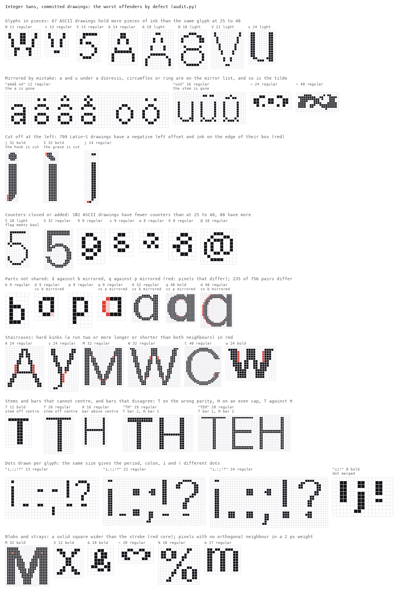
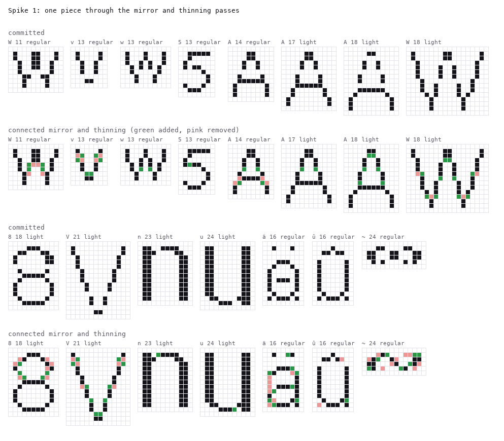
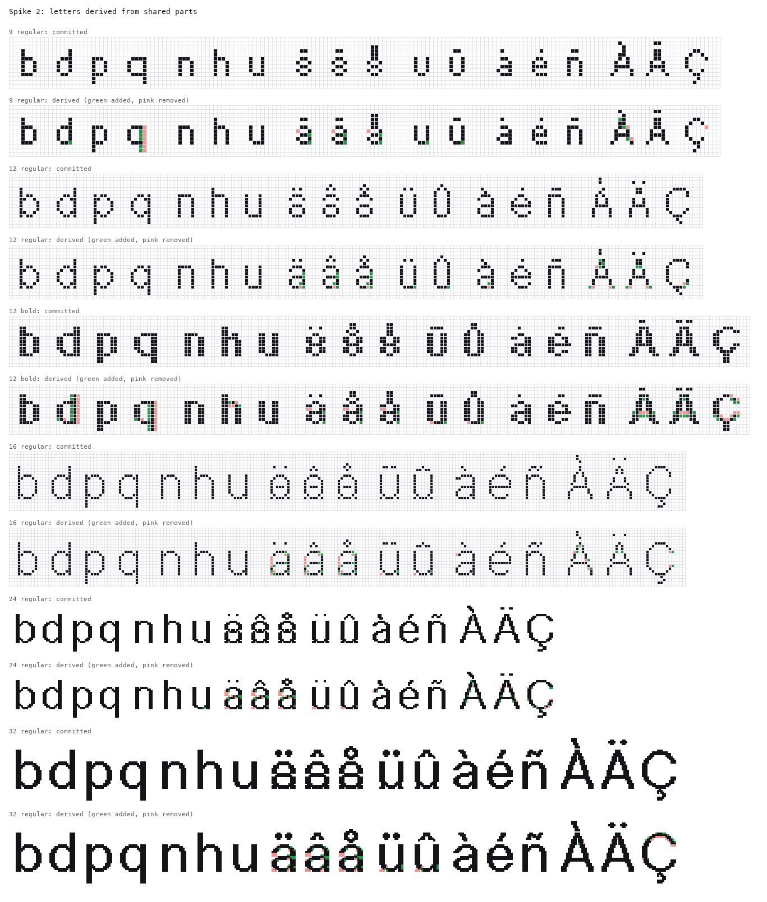
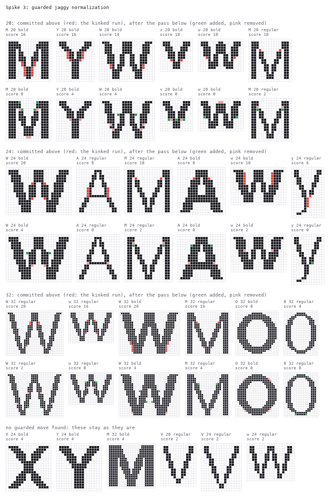

# Hand-drawn at every size: parts, parity, and staircases

_Plan, 2026-11-15. A second pass after [improving-integer.md](improving-integer.md). It answers one question: what further techniques make every size from 7 to 48 look drawn by a person, keep its symmetry, and stay consistent across glyphs, sizes, and weights. Every number below is printed by `experiments/hand-drawn/audit.py` or one of the spikes beside it, run on the committed drawings at `2dbfb1f`; the full table is `experiments/hand-drawn/audit.txt`._

## Thesis: a designer decides once per size, the pipeline decides once per glyph

The importer renders each glyph alone and each size alone. A person drawing a pixel font does the opposite: they settle the stem, the bar, the dot, the corner of a bowl, and where the odd pixel goes once for the size, then assemble letters from those decisions, and only then look at single glyphs. What reads as machine-made in the current drawings is almost never a wrong pixel judged against the outline. It is two letters that should share a part and do not, or one staircase that steps 4, 1, 3 where its neighbour steps 3, 2, 2.

So the next gains come from **rules that hold across glyphs and sizes by construction**, applied before any per-glyph search: a part is rendered once and reused, a size has one table of parameters, a staircase has one rhythm, a glyph has the pieces its outline has. The first plan's scorer and candidate search stay useful, but they score a glyph against its own outline, and a consistency defect is invisible to that score: `d` at 9px is a faithful render and still is not `b` mirrored.

Three places where the measurements disagree with the first plan:

- **"Large sizes are solved" does not hold for this font.** That claim rests on antialiasing, and Integer has none at any size. Staircase defects grow with size: hard kinks sit in 0.4% of ASCII drawings at 7 to 12 and 4.6% at 25 to 48; round letters with a non-monotone arc are 0 of the drawings at 7 to 16 and 41.0% at 25 to 48; bowl pairs that differ are 1.4% at 17 to 24 and 46.3% at 25 to 48. The display family needs this work more than the text family.
- **A fidelity score cannot be the only objective.** Spike 3 below is a search that lowers a staircase score by 71% and produces several drawings the eye rejects. Rules have to be constraints, as that plan says of structure, and part sharing has to be one of them.
- **Its component-count check should be a constraint inside the passes, not a score after them.** 67 ASCII drawings are in pieces today, and Spike 1 shows the two importer passes that break them can each refuse to.

## Findings

All counts are over printable ASCII (94 glyphs × 42 grids × 3 weights = 11,844 drawings) unless a row says Latin-1 (29,862 drawings). "Hand" columns are the same measures on bitmap strikes people drew: a grotesque sans hand-tuned for X11 at 8, 10, 12, 14, 18, and 24px, compared with Integer at the same six sizes. They turn a count into a rate: a measure a hand-drawn font also fails is not a defect.

### Defects that are bugs

| Finding | Count | Where |
|---|---|---|
| Drawings in more pieces than the same glyph at 25 to 48 | 67 ASCII; 148 of 12,798 Latin-1 at 7 to 24 | `~` 22, `W` 8, `u` 6, `A` 5, `w` `>` 4; Light 39, Regular 27, Bold 1; 13 of them at grid 13 |
| Counters closed, or added | 102 closed, 88 added | closed: `~` 56, `$` 8, `%` `8` `A` `a` `e` 6 each; added: `@` 24, `5` 21, `9` 11, `s` 8 |
| Letters mirrored that the source does not draw symmetric | 630 of 630 | `ä â å ü û` at every size and weight: the base `a` and `u` are folded onto themselves. The tilde is on the list too |
| Drawings cut at the left edge | 799 Latin-1 (2.7%) | every glyph with a negative `left`: `j`, grave accents, bold hooks |
| Dots merged into their letter | 17 | all at 7 to 12 |

Three causes, all read in `scripts/import-inter.py`:

1. The mirror pass clears both pixels of a disagreeing pair when their mean coverage is under 0.6. On a thin diagonal whose two legs the hinter snapped differently, that empties a row (`v` at 13, `A` at 14, `W` at 11).
2. The thinning tests each pixel of a mirror orbit alone, then removes the whole orbit. An apex two pixels wide passes the test twice and goes in one move.
3. The writer drops ink at `x < 0` and then also writes `left: -n`, which the build adds again. A glyph with a negative offset is both cut and shifted. This was read in the code and counted in the files; it was not confirmed in a rendered font.

The symmetry list (`SYM_LR`) contains `adieresis`, `acircumflex`, `aring`, `udieresis`, `ucircumflex`, and `asciitilde`. None is symmetric in the source.

### Hand-drawn look

| Measure | Integer, all | 7–12 | 13–16 | 17–24 | 25–48 | Hand, six sizes | Integer, same six |
|---|---|---|---|---|---|---|---|
| Drawings with a hard kink (a run 2+ longer or shorter than both neighbours) | 383 (3.2%) | 0.4% | 0.8% | 2.6% | 4.6% | 1 (0.2%) | 7 (1.2%) |
| Round letters (`o O 0 c C D b d p q`) with a non-monotone arc | 316 (25.1%) | 0% | 0% | 8.8% | 41.0% | 0 | 1 (1.7%) |
| Diagonal letters with uneven steps | 1077 (53.4%) | 12.2% | 40.6% | 50.3% | 66.9% | 12 (12.5%) | 30 (31.2%) |
| Pixels with no orthogonal neighbour, stems of 2+ | 334 | | | | | 6 | 32 |
| Drawings with a blob wider than the stroke | 237 (2.0%) | | | | | 20 (3.5%) | 6 (1.1%) |
| One-pixel bumps per drawing | 0.44 | 1.46 | 1.09 | 0.46 | 0.07 | 0.95 | 1.24 |

- Kinks concentrate in seven letters: `M` 66, `y` 64, `W` 60, `w` 57, `A` 52, `v` 22, `V` 18. These are the joins of a diagonal to a stem or to another diagonal. The likely cause is the thinning's rule changing from *k* across to *h* down mid-stroke; that was not traced.
- Uneven diagonals are the largest gap to the hand strikes (31.2% against 12.5% at the same sizes): `Y` 114, `M` 111, `W` 110, `/` 105, `\` 94, `w` 93, `A` 91, `V` 88, `K` 81, `v` 75 of 126 each.
- Round wobble is `C` 65, `c` 48, `D` 42, `O` 29: a quarter arc whose runs go 6, 4, 3, 1, 1 in one corner and 6, 4, 2, 1, 1 in the next.
- Strays: `~` 36, `*` 14, `m` 14, `%` 10. Blobs: `M` 59, `X` 20, `&` 19, `W` 17, `x` 16, `N` 15, the filled vertex where two heavy strokes meet.
- **One-pixel bumps and dents do not separate hand from machine** (0.95 and 1.24 per drawing). They are terminals, serifs of `1`, and corners. They are in the table to say so; no technique below targets them.

### Symmetry

| Measure | Integer, all | Hand regular, six sizes | Integer, same six |
|---|---|---|---|
| Left-right asymmetric, of 17 letters expected symmetric | 70 (3.3%): `T` 53, `W` 10, `8` 5 | 5 (4.9%) | 2 (2.0%) |
| Symmetric letter off centre in its advance by 1 | 312 (14.6%): `W` 59, `V` 52, `X` 47, `x` 42, `v` 40, `w` 36 | 20 (19.6%), and 4 more off by 2 | 15 (14.7%) |
| Top-bottom asymmetric, of 7 expected | 75 (8.5%): `H` 74 | 9 (21.4%) | 3 (7.1%) |

Symmetry is already at or above the hand strikes. What is left is parity, and the choice is made per glyph instead of per size:

- `T`: the bar's width and the stem's width have different parity in 53 of 126 drawings, so the stem cannot centre. It sits right of centre in 28 and left in 25.
- `H`: the bar is centred in 52 drawings, above centre in 64, and **below centre in 10**. A bar that cannot centre should always go up.
- Off centre by one is the ink's parity against the advance's. No glyph is off by two.

### Consistency

| Measure | Integer, all | Hand regular, six sizes | Integer, same six |
|---|---|---|---|
| Bowl and arch pairs that differ, 6 per size | 235 of 756 (31.1%) | 2 (5.6%) | 3 (8.3%) |
| Accented letters whose base is not the base letter (Latin-1) | 3397 of 6174 (55.0%) | 13 (4.4%) | 127 (43.2%) |
| Bars that are not the size's bar | 280 (15.9%): `f` `t` 45, `Z` 39, `T` `E` `F` 36, `z` 22 | 0 | 0 |
| Sidebearing classes with two values, 7 per size | 3 | 3 | 0 |

- Pairs: `d` is not `b` mirrored at 52 of 126 drawings, `q` is not `p` mirrored at 49, `u` is not `n` turned at 29, `h` is not `n` under an ascender at 10. By band: 24.1% of pairs at 7 to 12, 9.7% at 13 to 16, 1.4% at 17 to 24, 46.3% at 25 to 48.
- Accents are the widest gap to hand work in the whole audit: 55.0% against 4.4%. A person draws `é` as `e` plus an acute. The pipeline renders it as a glyph of its own, and presumably the hinter fits the taller shape differently; the cause was not traced.
- Corners: among `o c e d q g b p` the top corner has two or more templates at 24 of 42 sizes in Regular, and five at grid 45.
- Dots: the period, colon, `i`, and `!` use two or more dot sizes at 23 of 42 sizes in Regular (grid 22: 3×1, 3×3, and 2×1).
- **Spacing rhythm is already consistent**: 3 split classes in 882. Section 4 of the first plan can drop "round the sidebearings consistently" from its list; the drawings already agree.
- Across sizes, 11,562 steps from *n* to *n*+1: the advance shrinks at 58 (23 of them at 7→8), the ink box narrows at 147 (34 at 7→8), and the ink count falls at 1007, clustered where a parameter jumps: 23→24 (116), 45→46 (97), 27→28 (79), 31→32 (63).
- The bar gets thinner as the size grows at three steps: Light and Regular 23→24 (2 to 1 pixel) and Bold 32→33 (4 to 3).
- Bold over Regular stem swings between 1.33 and 2.0 with no trend: 2/1 to grid 16, 3/2 to 23, 4/2 to 28, 4/3 at 29 and 30, 5/3 to 36, 6/3 to 39, 6/4 to 43, 7/4 to 48.
- Light is the same file as Regular at 18 sizes: 7 to 16, 23 to 28, and 38 and 39. It differs at 17 to 22. The README says Light equals Regular below 23; the files say Light appears at 17, vanishes at 23, returns at 29, and vanishes again at 38.

## Techniques

Ranked by measured effect over cost. "Slot" is where it goes in the existing pipeline.

### 1. Topology as a constraint in the passes (spiked)

- **Fixes:** glyphs in pieces, closed and added counters, the left cut, and the six letters mirrored by mistake.
- **How:** the mirror pass falls back to a union when it leaves more pieces than it found; the thinning drops an orbit only if the piece count holds; a glyph still in more pieces than its outline at four times the size gets the best-covered joining pixel inked; the six names leave `SYM_LR`; the writer stops dropping columns it also offsets.
- **Evidence:** Spike 1. Grids 7 to 24, all weights, 12,798 Latin-1 drawings: 440 change (3.4%), drawings in pieces go from 148 to 0, accented bases that differ from 1089 to 889, kinks from 171 to 163, blobs unchanged at 60.
- **Cost:** small; four edits. The naive piece count in the thinning loop is slow: grids 7 to 30 took over 20 minutes against 8 for all 42, so it needs a local test (the 3×3 neighbourhood the thinning already reads) before it lands.
- **Risk to fidelity:** low. It only adds pixels the outline covers.
- **Slot:** importer (`_mirror_pass`, `pixel_perfect`, the writer); `check.py` gains the piece and counter count against the 4× outline as a failure.

Not everything it joins is good. `W` at 18 Light is in one piece and still uneven; that is technique 4's job.

### 2. Derivation rules for shared parts (spiked)

- **Fixes:** bowl and arch pairs, accented bases.
- **How:** a table in the importer config: `d = mirror(b)`, `q = mirror(p)`, `p = flip(b)` on its own descender, `h = n` under its own ascender, `u = turn(n)`, and every accented letter is its base's drawing with the accent rows kept. Each rule is applied after rendering and can be switched off per size or overridden per glyph in the override file, as now.
- **Evidence:** Spike 2, all 42 grids and 3 weights. Pairs that differ: 235 to 0 of 756. Accented bases that differ: 3397 to 0 of 6174.

| Rule | Drawings | Changed | Pixels moved | Share of ink | Advance changed |
|---|---|---|---|---|---|
| `d` = mirror `b` | 126 | 52 | 237 | 1.4% | 2 |
| `p` = flip `b` | 126 | 42 | 202 | 1.2% | 0 |
| `q` = mirror `p` | 126 | 44 | 338 | 2.0% | 4 |
| `h` = `n` + ascender | 126 | 10 | 21 | 0.1% | 0 |
| `u` = turn `n` | 126 | 29 | 214 | 1.6% | 0 |
| accent on base | 6174 | 3671 | 69,422 | 8.2% | 196 |

- **Cost:** small for the five letter rules. The accent rule moves 8.2% of the ink of the accented set, which is a lot. Part of it is the 630 mis-mirrored drawings and part is the accent shifting with its base; the spike does not separate the two, so run it again after technique 1 before judging it.
- **Risk to fidelity:** the source does not draw `d` as `b` mirrored exactly, nor `u` as `n` turned: the two differ in 24 of 72 drawings at 25 to 48, and why was not examined. At 7 to 12 the rule moves 7.7% of `d`'s ink and 12.8% of `q`'s, and at 9 Regular it gives `d` the square foot of `b`. A person may want that or not; it is a decision per size, which is why each rule needs the switch. Which master to derive from (`b` or the better-scoring of the pair) is open.
- **Slot:** importer, a new stage between rendering and writing; `check.py` asserts each rule that is on.

### 3. One parameter table per size

- **Fixes:** bars that disagree (280), dots (two or more sizes at 23 grids), the bar thinning at 23→24 and 32→33, Light appearing and vanishing, the Bold ratio, the ink drops at 23→24 and 45→46.
- **How:** a committed `params.txt` with one row per grid and weight: stem, bar, dot width and height, overshoot, the corner template, and the parity choices of technique 5. The importer reads it instead of measuring `h` off the rendered `H` and rounding `k` from a ratio. Generate the first version from today's values, then smooth it by hand: each column non-decreasing in the grid, Bold a fixed step rule over Regular, Light either present or absent over a whole range.
- **Evidence:** the per-size table at the end of `audit.txt`. Not spiked.
- **Cost:** medium. The table is small; making the importer honour a bar it did not measure (the source draws `T`'s bar and `E`'s arms at different thicknesses at some instances) needs the thinning to take the target as given.
- **Risk to fidelity:** low to medium; it overrides the source's bar where the source varies.
- **Slot:** new file read by the importer; `check.py` asserts each column is monotone.

### 4. Staircase normalisation (spiked, and not ready)

- **Fixes:** kinks, uneven diagonals, round wobble.
- **How:** a pass after the thinning that moves single pixels on a defective staircase, keeping pieces, counters, ink box, and stroke thickness, and for mirrored letters moving the mirror image too.
- **Evidence:** Spike 3 on grids 20, 24, 32, 40 in Regular and Bold, 752 drawings: 113 have a staircase defect, the summed score falls from 555 to 163, 45 are cleared, 210 pixels change in 114 moves.
- **What the pictures say:** `v` and `w` at 20 Bold and `A` and `y` at 24 reach a score of 0 with a few pixels moved along the staircase. `M` at 20 Bold also reaches 0, by adding pixels where the diagonals meet the stems and trimming the vertex: it changed the joins, not the staircase, and a person would not draw it. The pass has no access to the outline's coverage, so it takes the move that lowers the count, not the one the outline supports.
- **Cost:** medium. In the importer the moves must be ranked by coverage, and the round letters want a different method altogether (technique 6).
- **Risk to fidelity:** medium. It moves pixels the rasterizer placed; the guards bound it to 1.9 pixels per defective glyph in the spike.
- **Slot:** importer, after `pixel_perfect`, before the mirror pass re-runs.

For straight diagonals a simpler rule may beat the search: redraw the stroke's centre line between its two hinted ends as a Bresenham line, whose runs differ by at most one by construction, and brush it with the size's stem. Not measured.

### 5. A parity policy per glyph class

- **Fixes:** `T` (53), `H` below centre (10), the direction of the off-by-one (312).
- **How:** three rules in the parameter table. A stem under a bar: the bar's width takes the stem's parity, by one pixel. A bar that cannot centre goes up. A symmetric glyph whose ink and advance differ in parity puts the spare pixel on the right, always. An apex (`A V W M v w`) is one pixel wide on odd ink and two on even.
- **Evidence:** the symmetry table. The hand strikes are off centre more often than Integer (19.6% against 14.7%), so designers accept the half pixel; what they do not do is vary its side.
- **Cost:** small.
- **Risk to fidelity:** one pixel of a bar's width.
- **Slot:** importer, in `center_in_advance` and before the mirror pass; `check.py` asserts the side.

### 6. A corner template per size

- **Fixes:** round wobble (316), corner sets with several templates (152 of 252 across weights).
- **How:** per size and weight, pick one quarter-arc run sequence for the x-height bowls and one for the capitals (the mode among `o c e d q g b p`, or the candidate nearest the outline), then stamp it into all four corners of every bowl, mirrored and flipped. Technique 2 already does this for `b d p q`; this extends it to `o c e g a` and to `O C G Q D`.
- **Evidence:** at grid 34 Regular the bowls use three top corners (5-4-2-1-1, 6-4-3-2-1-1, 6-4-3-1-1); at 36 they all share one. The sizes that already agree show the target is reachable. Not spiked.
- **Cost:** medium to large. Finding the corner in a glyph and replacing it without disturbing the join to a stem is the work.
- **Risk to fidelity:** medium; the source's `c` and `o` do not share a curve exactly.
- **Slot:** importer, with technique 2.

### 7. Cross-size checks

- **Fixes:** nothing by itself; it stops regressions and finds parameter jumps.
- **How:** `check.py` reads all grids of a weight and reports, per glyph, any step where the advance or ink box shrinks, the pieces or counters change, or a parameter falls. The audit already computes these.
- **Evidence:** 58 advance decreases, 147 width decreases, 3 bar decreases; 67 drawings with more pieces and 40 with fewer than the large sizes, 102 with fewer counters and 88 with more.
- **Cost:** small. **Risk:** none. **Slot:** `check.py`; report first, gate once technique 3 has smoothed the table. Ink count should stay a report: it falls legitimately when the stem ratio changes.

### 8. Notches at heavy joins

- **Fixes:** blobs (237: `M` 59, `X` 20, `&` 19, `W` 17, `x` 16, `N` 15).
- **How:** where two strokes meet at an acute angle and fill a square wider than the stem, clear the inside corner pixel. The first plan's fix for `X` and `x` (keep arm width beside a crossing) is the same join seen from the other side; do them together.
- **Evidence:** counts only. Not spiked. The hand strikes have blobs at a higher rate (3.5% against 1.1% at the same sizes), so this is the weakest claim here: judge it by eye before building it.
- **Cost:** small. **Risk:** low. **Slot:** importer, after the thinning.

### 9. Stroke rendering with a pixel brush

- **Would fix:** staircases, corners, and terminals at once, since a brush of fixed size along a centre line gives constant thickness and regular steps.
- **Why it ranks last:** the source is an outline with a weight axis, not a skeleton. Extracting centre lines that stay stable across 42 sizes and three weights is a project the size of the current importer, and every difference between brush and outline is lost fidelity: stroke contrast, the taper of `a` and `e`, the cut of terminals. It is unmeasured here.
- **Take from it:** the two narrow uses above, a Bresenham centre line for straight diagonals and a stamped quarter arc for bowls, get most of what a brush gives without a skeleton.

### 10. Rating hand-drawn-ness

- **The audit is the score.** Its measures are defined on bitmaps alone and are calibrated: each has a rate on hand-drawn strikes. The ones that separate hand from machine are kinks, uneven diagonals, strays, bowl pairs, accented bases, and bar agreement. Bumps, dents, point symmetry of `S` and `N`, and centring do not, and should not be optimised.
- **Add it to the first plan's `scripts/score.py`** as the structure terms, beside fidelity. Spike 3 is the warning: a search that minimises them alone invents pixels.
- **A vision model stays a reviewer.** It was used here to read contact sheets and it found the classes of defect; it did not count them, and it was not tested as a rater. A fair test is to give it pairs (the hand strike and Integer at the same size, unlabelled) and ask which a person drew; untested.

## Plan

Each phase ends in a command that prints a number. Run them from the repo root.

### 1. Fix the bugs

Take the six names off `SYM_LR`. Make the writer keep columns left of the origin. Add the piece-count guards of Spike 1 to the mirror pass and the thinning, with a local connectivity test so the import time holds. Fail `check.py` on a piece or counter count that differs from the outline at 4×.

Done when:
- `.venv/bin/python experiments/hand-drawn/audit.py --count broken` prints 0 (today 67).
- `.venv/bin/python experiments/hand-drawn/audit.py --count 'negative left, ink on the box edge'` prints 0 (today 799).
- `.venv/bin/python scripts/import-inter.py` still finishes in under ten minutes.

### 2. Derive the shared parts

Add the rule table and the derivation stage. Turn on the five letter rules at every size; review the 7 to 12 sheet by eye and switch off what reads wrong. Re-run Spike 2's accent rule after phase 1 and turn it on if its cost falls.

Done when:
- `.venv/bin/python experiments/hand-drawn/audit.py --count 'pairs differing'` prints 0, or the number of rules switched off (today 235).
- `.venv/bin/python experiments/hand-drawn/audit.py --count 'accented base differs'` prints under 300, the hand rate of 4.4% on 6174 (today 3397).

### 3. Write the parameter table and the parity policy

Commit `params.txt`, generated then smoothed. Make the importer read stem, bar, and dot from it. Add the three parity rules. Decide Light's range here, with section 7 of the first plan.

Done when:
- `.venv/bin/python experiments/hand-drawn/audit.py --count 'h decreases'` prints 0 (today 3).
- `.venv/bin/python experiments/hand-drawn/audit.py --count 'bars off'` prints under 30 (today 280).
- `.venv/bin/python experiments/hand-drawn/audit.py --count 'lr asymmetric glyphs'` prints under 20 (today 70, of which `T` is 53).

### 4. Regular staircases

Draw straight diagonals from a Bresenham centre line and compare against Spike 3's search, ranked by coverage, on the seven worst letters. Stamp one corner per size into the bowls. Keep whichever the sheet and the count both prefer.

Done when:
- `.venv/bin/python experiments/hand-drawn/audit.py --count 'kink glyphs'` prints under 60 (today 383; the hand rate is 0.2%, Integer's is 3.2%).
- `.venv/bin/python experiments/hand-drawn/audit.py --count 'round wobble glyphs'` prints under 60 (today 316).
- A person has looked at `M W A y w` at 20, 24, 32, and 40 in both weights and none has a pixel the outline does not cover.

### 5. Gate it

Move the audit's measures into `scripts/check.py` and the first plan's `scripts/score.py`. Fail the build on pieces, counters, a rule that is on and broken, a parameter that falls, and a parity side that flips. Report the rest.

Done when: `.venv/bin/python scripts/check.py` fails on a drawing with `d` edited by one pixel and passes when the edit is in an override that also switches the rule off for that size.

## Not on the plan

- Replacing the outline path with a skeleton and brush. See technique 9.
- Removing one-pixel bumps and dents. Hand-drawn strikes have as many.
- Forcing `S` and `s` to point symmetry. The source does not draw them so, and the hand strikes miss it as often (11 of 12 drawings in both). `N Z z` are open: the hand strikes miss it in 6 of 18 and Integer in 12 of 18 at the same sizes, which was not looked into.
- Changing advances to make every symmetric glyph centre. The half pixel has to go somewhere; only its side should be fixed.
- A generative or vision model choosing pixels. Unchanged from the first plan.

## What was not verified

- The left cut was read in the importer and build and counted in the files, not rendered through FreeType.
- Spike 1 covers grids 7 to 24. A run over 25 to 48 was stopped at grid 31 for time.
- Spike 3 covers eight of 126 grid and weight pairs, ASCII only.
- Techniques 3, 5, 6, 7, 8, and 9 have counts for the defect and no prototype of the fix. The thresholds in the plan's tests are targets, not measured outcomes.
- The hand reference is one typeface at six sizes plus one pixel face at two; rates from it are a guide, not a norm.
- No spike output was built into a font or passed through `scripts/check.py`.

## References

- Inglis, Kaplan. *Pixelating Vector Line Art.* NPAR 2012 (rasterizing line art to pixel-art conventions; names jaggies and broken lines as the failures of plain rasterizers). https://diglib.eg.org/items/3468d785-2fb6-498f-8947-e1fc587f6675
- Inglis, Vogel, Kaplan. *Rasterizing and antialiasing vector line art in the pixel art style.* NPAR 2013. https://dl.acm.org/doi/10.1145/2486042.2486044 (the page refuses automated fetches; title and authors taken from a search listing, text not read)
- Hersch, Bétrisey. *Model-based matching and hinting of fonts.* SIGGRAPH 1991 (a topological model of letter parts shared across glyphs). https://infoscience.epfl.ch/bitstreams/157b7398-1792-4691-846c-62c22a8440fe/download
- Hobby. *Rasterization of nonparametric curves.* ACM Transactions on Graphics, 1990. https://dl.acm.org/doi/10.1145/78964.78966
- Knuth. *The Concept of a Meta-Font.* Visible Language, 1982 (a face as parameters and pens). https://archive.org/details/the-concept-of-metafont
- Shamir, Rappoport. *Feature-Based Design of Fonts Using Constraints.* EP/RIDT 1998 (shared parts as constraints). https://dl.acm.org/doi/10.5555/647506.760425
- Derek Yu. *Pixel Art Tutorial: Basics* (jaggies defined as pixels that break a line's consistency). https://derekyu.com/makegames/pixelart.html
- Aseprite, pixel-perfect mode for freehand tools, the commit that added it. https://github.com/aseprite/aseprite/commit/15548756180eb78872718d54acde3fbcfe833303
- X.Org `font/adobe-75dpi`, the hand-tuned strikes used as the reference (fetched by `experiments/hand-drawn/fetch_refs.py`; measured, not redistributed). https://gitlab.freedesktop.org/xorg/font/adobe-75dpi
