# Straight diagonals and clean apexes

2026-11-26. The research below came first and changed nothing under `glyphs/` or `scripts/`. The last section, Outcome, is what was then built into the importer. Code, numbers and pictures are in `experiments/straight-diagonals/`.

## Finding

A fixed rise over run is possible. Redrawing each straight stroke as an evenly stepped line between the ends the committed drawing already has takes the study set from 344 bent edges of 1015 to 88 of 995, and from 80 hard kinks to 0, with no width or advance change. The remaining 88 are in y, K, k, Z, z, x and n, and are listed under "What the prototypes do not fix".

The flare comes from the erosion pass, not from hinting or the row warp. Bent edges are 152 of 1259 before the first `thin()` call and 416 of 1270 after it.

The doubled pixel at the apex is a parity effect. A symmetric letter whose width minus its stem is odd cannot have an apex one stem wide. That is 41 of the 90 committed A, V, v drawings. Fixing it costs 1 px of width and advance on those sizes.

## The two complaints, read against the drawings

"A looks like an Eiffel tower": confirmed. Example, A 20 Bold, outer edge of a leg, rows per column from the top: 3-1-4-3-2-2. A straight edge over the same 15 rows and 6 columns is 2-3-2-3-2-3. A 48 Bold: 2-2-3-2-2-3-4-4-2-3-2-2-3-1.

The mean bow of the full-height legs is small (A Bold +0.08 px toward the centre, v Bold +0.23 px, V Light -0.04 px). The flare is not a consistent curve in one direction. It is uneven steps: the eye reads a long run next to a short run as a change of angle.

"Doubled pixels at the center point": confirmed as reading (a). In the end row of A, V, v the ink is one pixel wider than the stem in 11 of 30 Light, 12 of 30 Regular and 18 of 30 Bold drawings. On A 12 Regular the 2 px apex is held for 3 rows. It is already there in the unhinted 1-bit render of the outline, so the erosion pass did not create it.

"One pixel tall bolds": the reading differs in part from the brief. I found two things, and cannot tell from the sentence which one is meant.

- Bold diagonals narrower than the stem. 242 rows of Bold outer diagonals are thinner than the size's stem (Light 80, Regular 123). Example, A 9 Bold has legs `.#..#.` for 2 rows in a 2 px weight.
- Bold at 9 to 16 px has a 2 px stem and a 1 px bar. Z 9 Bold has a top bar of `#####` over `####.`, a second bar row one pixel short, and a 1 px diagonal below it.

I did not find horizontal bars whose staircase steps are doubled. The second item above is the closest match.

n: n has no straight diagonal. Its shoulder is an arch, and the metric marks 14 of 15 n edges bent because a curve is not a straight line. The prototypes leave n unchanged (0 pixels). If n looks wrong to Nicholas the cause is the arch, which is outside this study.

## Measure

`measure.py` takes edges from the bitmap alone: the column of one side of a stroke in consecutive rows. An edge that spans 4 or more rows and 2 or more columns is a diagonal.

- bent: the edge is not a digital straight line. Its pixels do not fit inside a band one pixel wide at any slope.
- excess: mean pixels outside the best band.
- kinks: a run 2 or more longer or shorter than both neighbours (the 1-3-1 pattern).
- uneven: interior runs that differ by 2 or more.
- back: steps against the edge's direction.
- thin: rows of an outer diagonal narrower than the stem.

Committed drawings, letters `A V v W w X x Y y K k M N Z z 7 / \ < >`, ten grids (7, 9, 10, 12, 13, 16, 20, 24, 32, 48):

| weight | edges | bent | | excess | kinks | uneven | back | thin |
|---|---|---|---|---|---|---|---|---|
| light | 430 | 121 | 28.1% | 0.07 | 26 | 40 | 11 | 80 |
| regular | 431 | 140 | 32.5% | 0.09 | 23 | 51 | 9 | 123 |
| bold | 409 | 157 | 38.4% | 0.15 | 39 | 59 | 1 | 242 |
| all | 1270 | 418 | 32.9% | 0.10 | 88 | 150 | 21 | 445 |

179 of 600 drawings have a bent edge. On all 42 grids (7 to 48): 3157 of 6468 edges bent (48.8%), 502 kinks, 1296 of 2520 drawings.

It gets worse with size. Bent share by grid, Regular then Bold: 9 px 0.0%, 8.3%. 13 px 14.6%, 24.4%. 20 px 29.1%, 54.5%. 24 px 37.3%, 63.0%. 48 px 74.6%, 69.8%. The full table is `measure.txt`.

By letter, bent edges of edges: W 52 of 94, y 36 of 63, A 30 of 60, V 28 of 60, w 34 of 72, M 26 of 52, `>` 49 of 76, `<` 39 of 78. `/` and `\` are 0 of 116.

These counts are not the same measure as the earlier audit on `plan-hand-drawn` (930 kinks in 11,844 drawings). That audit counted per drawing over all ASCII. This one counts per edge on 20 letters.

## Cause

`stages.py` runs the importer's own functions and scores the same letters after each stage. Its last stage equals the committed drawing in 600 of 600.

| stage | edges | bent | | kinks | uneven | back | thin |
|---|---|---|---|---|---|---|---|
| outline, 1-bit, no hinting | 1268 | 190 | 15.0% | 49 | 7 | 3 | 193 |
| rows warped onto the grid | 1264 | 167 | 13.2% | 58 | 6 | 3 | 210 |
| autohinted | 1259 | 152 | 12.1% | 43 | 8 | 3 | 223 |
| first mirror | 1251 | 187 | 14.9% | 48 | 22 | 9 | 192 |
| first `thin()` | 1270 | 416 | 32.8% | 90 | 153 | 19 | 452 |
| final | 1270 | 418 | 32.9% | 88 | 150 | 21 | 445 |
| mirror, no `thin()` | 1251 | 173 | 13.8% | 38 | 8 | 3 | 185 |
| `thin()`, no mirror | 1289 | 369 | 28.6% | 96 | 145 | 18 | 400 |

- The row warp (`warp_map`, `scripts/import-inter.py` line 151) and the autohinter (`FT_LOAD_FORCE_AUTOHINT`, line 588) do not raise the count. Each lowers it.
- `thin()` (line 265, called at 616, 618 and 620) more than doubles it. Uneven runs go from 22 to 153.
- The mechanism is in `removable()` (lines 295 to 316). A pixel goes when its horizontal run is longer than the stem on a locally steep stroke (line 306), least covered first. The test is per pixel. It has no slope and does not see the run sequence along the edge, so it shortens some steps and not others. It also explains the thin rows: a diagonal's row that is one over the stem loses a pixel wherever connection allows.
- The mirror pass (`symmetrize`, line 449) is a small contributor: 152 to 187 bent, uneven 8 to 22.
- 190 edges are bent before anything else runs. I did not find out why. Candidates are tapered strokes in the source, joins caught by the edge extraction, or 1-bit sampling.

## Options

### (i) Redraw between fixed ends. Prototyped as `fixed`.

Each letter has a recipe in `redraw.py`. It reads the anchors from the committed drawing (ink box, where each stroke starts and ends, bar rows, the stroke's median horizontal thickness) and stamps each stroke again. The columns are spread evenly over the rows, centred, so runs differ by at most 1 and both ends get a full run. Every row of a stroke has the same horizontal thickness.

- Width and advance: unchanged in 510 of 510.
- Symmetry: held by drawing one side and mirroring.
- Apex: the narrowest the box's parity allows. It does not remove the 2 px apex on the 41 odd-parity drawings.
- Slope: the nearest to straight for the given ends, usually two run lengths mixed (2-3-2-3). Not a single run length.
- Adjacent sizes: each size keeps its own box, so slopes change with size as they do today.

### (ii) Choose the width so the apex is one stem wide. Prototyped as `parity`.

As (i), and A, V, v, W, w are made 1 px wider or narrower when width minus stem is odd. The direction is the one that gives the more even runs. W and w get bottom vertices one stem wide.

- Width and advance: changed by 1 px in 70 of 510 drawings (59 wider, 11 narrower. A 17, v 16, w 14, W 13, V 10. Bold 28, Light 21, Regular 21).
- Apex: one stem wide in 86 of 90 A, V, v drawings, and 1 px under the stem in 4 Bold ones where the committed leg is thinner than the stem.
- Slope as a simple ratio (1/1, 1/2, 2/3): only where the box allows it. Forcing a ratio at every size needs up to 2 or 3 px of width. I did not prototype forcing it.
- Adjacent sizes: a letter can be wider at 12 px than at 13 px relative to its neighbours. Visible in the proof at 12 px, where the line grows from the changed advances.

### (iii) Straighten the outline before rasterising. Not prototyped.

The stage table argues against it. The warp does not bend the diagonals in aggregate (190 to 167), and an unwarped, unhinted 1-bit render is already bent on 190 edges. A straighter outline still goes through `thin()`.

### (iv) Clean-up rules on the finished bitmap. Not prototyped here.

The earlier spike on `plan-hand-drawn` (`spike_jaggies.py`) took M 20 Bold from 16 kinks to 0 and W 24 Bold from 20 to 4, found no safe fix for X 24 Bold or V 20 and 24 Regular, and reached 0 on M by changing the joins. A local rule cannot move an end pixel, so it cannot even out a stroke whose runs are wrong along its whole length.

### (v) Exempt diagonals from `thin()`. Measured, not drawn.

Mirror with no erosion gives 173 bent edges and 38 kinks, close to the hinted render. The strokes then keep the autohinter's thickness. By `thin()`'s own description that is over the stem on curves and diagonals. I did not measure by how much.

## Results

Study set for the prototypes: `A V v W w X x Y y K k M N Z z 7 n`, ten grids, three weights, 510 drawings. Before, on this set: 1015 edges.

| | edges | bent | | excess | kinks | uneven | back | thin | bent drawings | pixels changed | width changed |
|---|---|---|---|---|---|---|---|---|---|---|---|
| committed | 1015 | 344 | 33.9% | 0.10 | 80 | 140 | 21 | 445 | 160 of 510 | | |
| fixed | 995 | 88 | 8.8% | 0.05 | 0 | 4 | 3 | 182 | 67 of 510 | 5162 | 0 |
| parity | 1003 | 88 | 8.8% | 0.05 | 0 | 4 | 3 | 212 | 67 of 510 | 6407 | 70 |

- fixed: 412 drawings redrawn, 90 identical to the committed drawing, 8 where the recipe gave up and kept the original (z 7 Light, Regular and Bold, y 7 Bold, k 7, 9 and 10 Bold, M 7 Bold). Ink 37,877 pixels before, 38,411 after.
- parity: 416 redrawn, 87 identical, 7 kept. Ink 38,194 after.
- A, V, v, W, w, X, Y, M, N: 0 bent edges in both modes (230 before).
- By weight, bent edges before and after `fixed`: Light 93 to 26, Regular 116 to 27, Bold 135 to 35.

The numbers are in `proto.txt`. The prototype bitmaps are written as text to `out/` (not committed, `proto.py` regenerates them).

Pictures. Each sheet has the committed drawing above and the redraw below. Green pixels were added, pink removed.

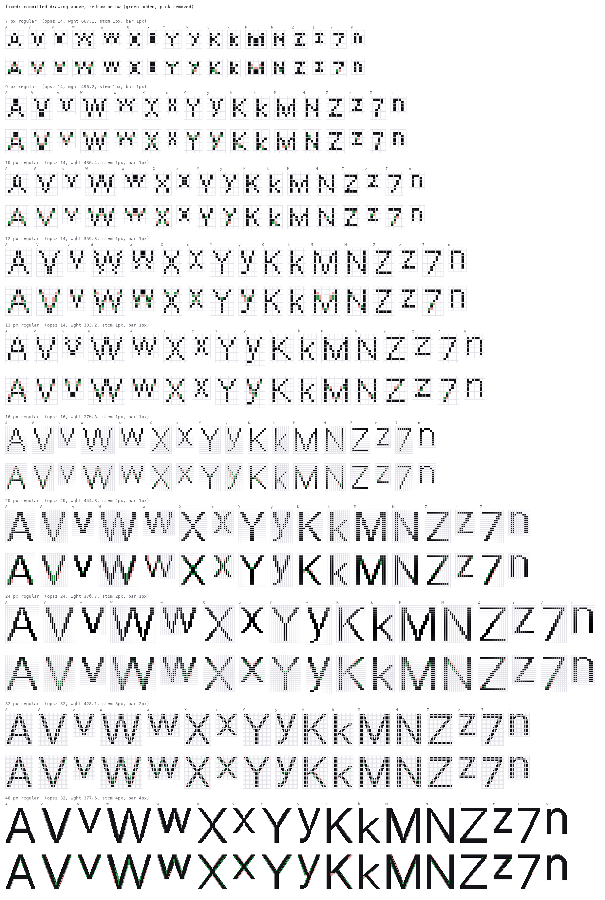
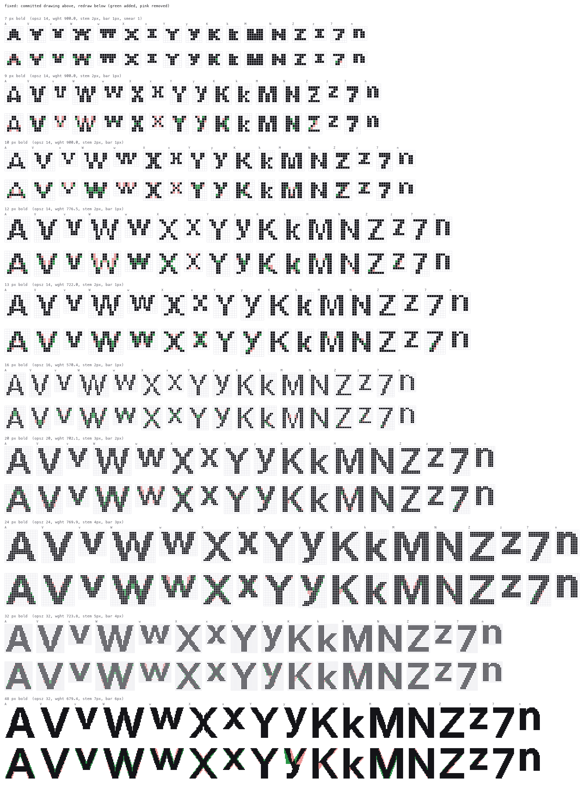
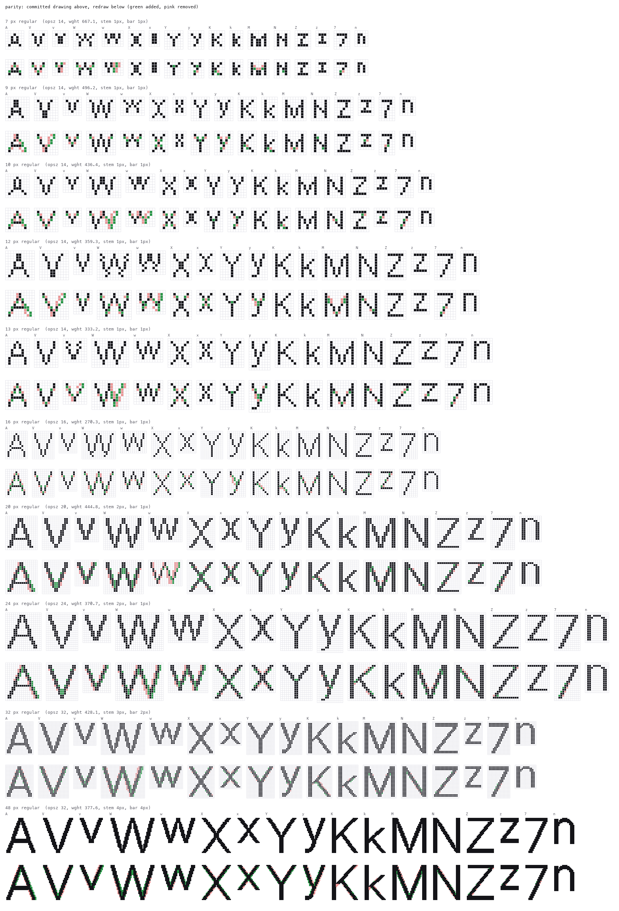
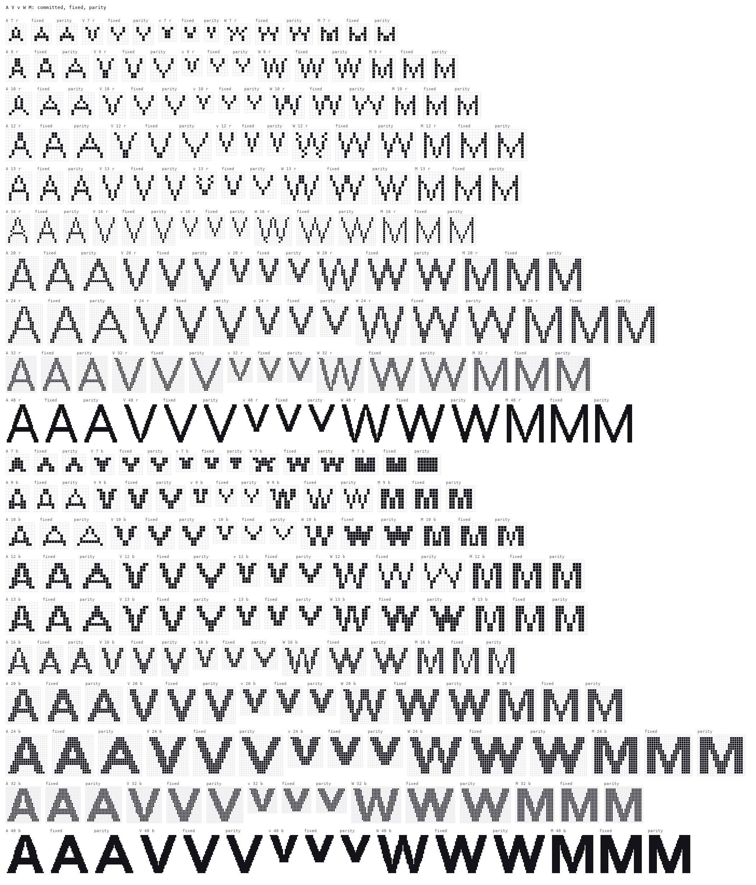
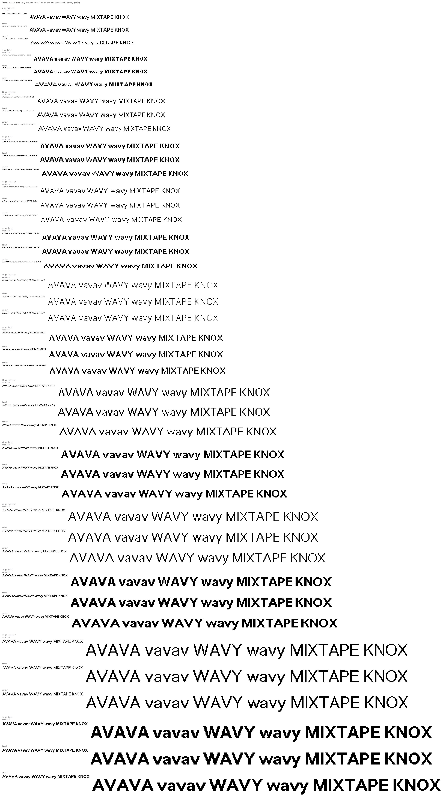

Also in `img/`: `sheet-fixed-light.png`, `sheet-parity-light.png`, `sheet-parity-bold.png`.

What I saw in them:

- A, V, v, W, w, M, N, X read as straight at 16 px and up. The A 20 Bold apex goes from 4 px held 3 rows to 4 px held 2 rows in `fixed` and 3 px in `parity`.
- Below 13 px the proof line at 1x is hard to tell from the committed one.
- W 12 Bold comes out lighter than its neighbours in the proof. I did not trace why. The recipe takes its thickness from the committed strokes, so a thin committed stroke stays thin.
- y keeps a bend where the redrawn stroke meets the kept hook (y 20 Regular, y 24 Bold).
- K's arm is one pixel per row at 20 Regular and 24 Bold and its leg mixes runs of 1 and 2, so the two halves do not match.

## What the prototypes do not fix

- y: 30 of 71 edges still bent (36 of 63 before). The long stroke is redrawn down to the hook and the hook is kept, so the edge has a bend where they meet.
- K: 13 of 50, worse than the 7 of 51 before. k: 6 of 39 (6 of 41 before). I did not find which sizes or why.
- Z 9 of 57, z 10 of 49, x 4 of 84, 7 2 of 60. Not investigated.
- n: 14 of 15, unchanged. Not a straight stroke.
- Thin rows: 182 remain, 166 of them Bold. The recipes copy the committed stroke's median thickness, which in Bold is often under the stem. Stamping at the stem instead makes Bold diagonals heavier. I did not measure or draw that.
- `/ \ < >` were measured and not prototyped. `<` and `>` are 88 bent of 154 edges.
- The recipes read anchors from an eroded bitmap. Where erosion moved an end, the redraw inherits it.

## Recommendation

Do (i) in the importer: after `thin()`, redraw the straight strokes of the letters above between their ends, taking the ends from the hinted outline rather than from the eroded bitmap, at the size's stem. Cost on this set: 412 of 510 drawings change, 5162 pixels, no width or advance change. Per-letter recipes are needed (16 letters here), and y, K, k need better join rules than the prototype has before they ship.

Decide (ii) separately, as a design call. It is the only option that removes the doubled apex pixel. Cost: 1 px of width and advance on 70 of 510 drawings here, and a letter's width no longer follows the source's proportions at those sizes. A middle path is to apply it to A, V, v only (43 of the 70).

Ranked after those: (v) as a cheap partial step if the heavier diagonals are acceptable, then (iv), then (iii).

## Not verified

- Nothing was run through the importer, `scripts/build.py` or `scripts/check.py`. The proof line is composed from the prototype bitmaps and the committed advances, not rendered from a built font.
- The prototypes ran on ten grids. The other 32 were measured (`measure-all.txt`) and not redrawn.
- Accented letters and other glyphs that reuse these shapes were not looked at.
- Kerning and spacing after the `parity` width changes: only the one proof line.
- The edge extraction was not checked letter by letter against pictures. Edge counts differ between runs (1015, 995, 1003) because a redraw can merge or split edges.
- Why 190 edges are bent in the unhinted outline render.
- Whether "one pixel tall bolds" means thin Bold diagonals, the 1 px Bold bar at 9 to 16 px, or something else.
- I looked at the Regular and Bold `fixed` sheets, the apex sheet and the proof. I did not look closely at the Light sheets or the `parity` Bold sheet.

## Outcome

Built into the importer after the research above: option (i) as a stage after the erosion (`scripts/diagonals.py`), a stroke table per instance, and option (ii) as `--parity`, with `avv` (A, V, v only) the default. All 42 grids were regenerated with it. Numbers compare `main` at 9eb8f34 with the regenerated drawings; where a third number is given it is the same redraw with parity off, the state of this branch before the default was chosen.

### What was built

- Redraw. `A V v W w X x Y y K k M N Z z 7 / \` are drawn again from their strokes after the erosion. Stroke ends, bar rows and feet come from the hinted render. 2085 drawings were redrawn. In 52 the redraw was refused and the eroded drawing stayed.
- A redraw is taken only when it is one piece, fills the same box, keeps the same counters, is no lighter, and is no less straight than the eroded drawing. That last test is what keeps K from getting worse.
- `<` and `>` are not redrawn. The recipe was built and removed: it made `<` 24 Regular less even than the erosion does.
- Diagonal thickness. A stroke leaning s columns a row is stamped stem × √(1 + s²) wide along the row, in whole pixels and never under the stem, so it is as thick across as a stem. Two strokes that cross (X, x) may be 0.6 px thinner across.
- Bars. Bold bars equal the stem where x-height ≥ 3 × stem + 2 × max(1, stem − 1): three bars and two counters, each counter at least a row and at least the bar less one. That holds at 14, 15 and 16 rows only, where the bar goes from 1 to 2 px. At 7 to 13 the counters of e, a, s would close. From 17 up the rule does not hold either, and the bar is the source's own, one under the stem (two under at 33 to 36).
- Parity. A, V and v change width by 1 px when width minus stroke is odd, so the apex is one stroke wide. This is `--parity avv`, the default. With `--parity all`, W, w and M may too, but only when no stroke gets thinner for it. `--parity off` keeps every width.

### Straightness

`measure.py`, 20 letters. Ten grids (7, 9, 10, 12, 13, 16, 20, 24, 32, 48), 600 drawings:

| | edges | bent | | kinks | uneven | back | thin rows | drawings with a bent edge |
|---|---|---|---|---|---|---|---|---|
| main | 1270 | 418 | 32.9% | 88 | 150 | 21 | 445 | 179 |
| this branch | 1243 | 140 | 11.3% | 20 | 16 | 3 | 22 | 68 |

All 42 grids, 2520 drawings:

| | edges | bent | | kinks | uneven | back | thin rows | drawings with a bent edge |
|---|---|---|---|---|---|---|---|---|
| main | 6468 | 3157 | 48.8% | 502 | 1048 | 75 | 3264 | 1296 |
| this branch | 6297 | 971 | 15.4% | 59 | 174 | 7 | 58 | 434 |

Parity changes none of these counts: with it off the rows are the same but for the edge totals (1241 and 6295).

Bent edges by letter on the ten grids, main then this branch: A 30, 0. V 28, 0. v 16, 0. W 52, 2. w 34, 2. X 24, 0. x 28, 4. Y 10, 0. y 36, 19. K 7, 0. k 6, 3. M 26, 0. N 10, 0. Z 12, 9. z 9, 6. 7 2, 1. `/` 0, 0. `\` 0, 0. `<` 39, 43. `>` 49, 51.

- 94 of the 140 bent edges left on the ten grids are `<` and `>`, which are not redrawn. They are 4 and 2 worse than main. I did not trace which sizes.
- y keeps a bend where the stroke meets the hook. Z and z keep some where the diagonal meets the bars.
- The audit from `plan-hand-drawn`, printable ASCII, 11,844 drawings: hard kinks 923 to 104, diagonal glyphs with uneven steps 1080 to 229 (223 with parity off), N Z z not point-symmetric 283 to 173.

### Doubled apex

End row of A, V, v wider than a leg, of 378 drawings (42 grids, three weights, `compare.py`):

| | all | Light | Regular | Bold | A | V | v |
|---|---|---|---|---|---|---|---|
| main | 202 | 65 | 63 | 74 | 72 | 61 | 69 |
| redraw, parity off | 190 | 67 | 61 | 62 | 63 | 60 | 67 |
| this branch (`avv`) | 24 | 7 | 7 | 10 | 4 | 6 | 14 |

The redraw alone does not fix it; the width change does. The 24 left: v at 7, 8 and 11 in every weight and at 13 and 14 Light and Regular, V at 9 and 12 Light and Regular, A at 8 and 9 Bold, and in Bold v 44, V 45, A 46, V 46, A 47. I did not trace why each of those stays.

On the eight grids of the parity sheets (9, 10, 12, 16, 20, 24, 32, 48), of 72: 37 on main, 32 with parity off, 5 with `avv` or `all`.

Cost: 171 of the 378 A V v drawings are 1 px wider (A 61, V 56, v 54), and so are the six accented A, 61 each: 537 advances, none narrower. The ink grows with the advance, so the side bearings of A, V and v are the same as on main in all 378. By band, A V v only: 9 at 7-12, 14 at 13-16, 38 at 17-24, 110 at 25-48. On the eight sheet grids `avv` changes 105 advances and `all` 118 (those, and W 7 wider and 2 narrower, w 4 wider).

### Weight consistency

`weight.py` finds the stems, bars, diagonals and round extremes of every drawing and compares each with the instance's nominal stem or bar. A stroke deviates when it is over 0.5 px off. Density is ink over advance against the instance's median, deviating at 20%. Letters and digits (A-Z a-z 0-9), 62 per instance, 7812 in all. Glyphs with a deviating stroke:

| | stem | bar | diagonal | round | density | diagonal under stem | bar under stem | any |
|---|---|---|---|---|---|---|---|---|
| main, Light | 49 | 153 | 96 | 302 | 73 | 96 | 221 | 621 |
| branch, Light | 34 | 154 | 46 | 302 | 104 | 25 | 222 | 586 |
| main, Regular | 47 | 167 | 176 | 176 | 69 | 176 | 565 | 590 |
| branch, Regular | 30 | 168 | 49 | 176 | 81 | 34 | 570 | 466 |
| main, Bold | 36 | 165 | 322 | 212 | 47 | 322 | 983 | 700 |
| branch, Bold | 29 | 154 | 104 | 208 | 48 | 65 | 899 | 486 |

Glyphs with any deviating stroke, by size band, main then this branch:

| | 7-12 | 13-16 | 17-24 | 25-48 |
|---|---|---|---|---|
| Light | 56, 53 | 11, 14 | 50, 54 | 504, 465 |
| Regular | 56, 48 | 12, 13 | 67, 69 | 455, 336 |
| Bold | 85, 80 | 20, 13 | 75, 58 | 520, 335 |

- Diagonals thinner than the stem: 594 glyphs to 124.
- Bold bars under the stem at 13 to 16: 115 glyphs to 30. The 30 are at 13 rows, which has no room.
- Not improved: round strokes (690 to 686) and bars (485 to 476). The erosion still takes the top and bottom of a round letter a row under the bar at large sizes. That is most of the 25-48 column.
- Worse: density deviations, 189 to 233 (Light 73 to 104, Regular 69 to 81, Bold 47 to 48). Light and Regular at 13 to 24 went up by a few glyphs in the `any` column too. A diagonal rounded up to a whole pixel is darker than its neighbours where it used to be lighter.
- With parity off the `any` column was 586, 471 and 487 and density 99, 81 and 53: the width change moves a handful of glyphs each way and the totals stay (any 1544 to 1538, density 233 and 233).
- Full tables per instance, with the worst glyphs named: `weight-main.txt` and `weight.txt`.

### Cost

- 3894 of 29,862 drawings changed, 85,671 pixels. By band: 7-12 393, 13-16 882, 17-24 632, 25-48 1987. By weight: Light 1099, Regular 1113, Bold 1682. Ink 3,356,091 to 3,387,346 pixels. (Parity off: 3880 drawings, 72,507 pixels.)
- 580 advances changed. 537 are the parity change: A, V, v and the six accented A, 1 px wider. The other 43 are on no redrawn letter (28 wider, 15 narrower by 1 px). They come from the bar refit at 14 to 16 Bold, where the hinter rounds a few letters another way (S, r, t, $, µ, æ, œ and accented forms). The list is in `compare.txt`.
- Import time: 6 min 46 s for the 42 grids (405 s with parity off, 406 s with `avv`; the last full run before this change took 412 s).
- The audit also moved the wrong way on three lines: glyphs with a blob wider than the stroke 251 to 716, top-bottom asymmetric 75 to 114, one-pixel dents 2522 to 2687. I did not trace them. The joins of the redrawn letters (apex, vertex, where two strokes meet) are the likely place.

### Guarantees from the two earlier importer changes

Unchanged: colon and semicolon built from the period and comma in 126 of 126 files, accented letters whose base differs 0 of 6174, 1 accent touching its letter (Ü at 7 rows), at most 1 row of ink above the ascent. Drawings above the ascent: 108 in 39 files before, 112 in 38 after. Drawings in more pieces than at 40 Regular: 84 before and after.

### Spacing

The width change moves advances, so the spacing was measured and looked at.

- Side bearings. In all 378 A V v drawings both bearings are what they are on main. Where the letter is wider, the ink and the advance grew by the same pixel.
- Least white gap on a shared row between A, V or v and each of A-Z a-z 0-9, both orders, 46,872 pairs over the 126 instances, main to this branch: same in 40,077, 1 px wider in 3493, 2 px wider in 52, 1 px closer in 3237, 2 or 3 px closer in 13. Pairs that touch: 1196 on main, 1302 here; 111 touch here and not on main: 76 at 7 to 12 rows, 33 in Bold above that (`kv` 16, `KV` 10), 2 in Regular. With parity off it was 1308 and 117: the closer pairs come from the redraw, whose legs run to the corners of the box, not from the width change.
- From the built fonts (FreeType), the width in pixels of `AVAVA vavav WAVY wavy MIXTAPE KNOX Hamburgefonstiv`, main to this branch: 10 px 306 to 306 and Bold 336 to 336; 12 px 351 to 356, Bold 386 to 399; 16 px 456 to 456, Bold 474 to 480; 20 px 570 to 580, Bold 604 to 609; 24 px 674 to 684, Bold 710 to 718; 32 px 869 to 869, Bold 932 to 945. The 16 Bold figure includes the bar refit's advances.
- In those lines `AV` and `VA` are 1 px further apart than on main at 12 Bold, 16, 20, 24 Regular and 32 Bold, and 1 px closer at 10 px, where no advance changed. `av` and `Av` are 1 px closer at 10 px (2 to 1) and `va`, `av` at 12 Bold (2 to 1). The font has no kerning, on main or here.

`proof-1x.png` and `proof-4x.png` set that line and `Vav Ava Avo Tav` at 10, 12, 16, 20, 24 and 32 px, Regular and Bold, main above this branch. What I saw: from 12 px up the lines are a few pixels longer and read as evenly spaced as main's; I could not pick out a pair that looks wrong. At 10 px Bold the A V v pairs are visibly tighter than on main (`Vav Ava` nearly closes up inside the words); that is the redraw, and it is the same with parity off.

### `/` and `\`

Set side by side in the diagonal sheets, `/\` reads as one `Λ` at 12, 24 and 32 Bold. That is not from this branch. The advance and both side bearings of `/` and `\` are the same as on main in all 126 instances, in the drawings and in the built fonts at the six proof sizes. On main the two already touch at the top: 93 of the 126 instances have no white column between the top of `/` and the top of `\` (at 12, 24 and 32 Bold both bearings are 0), and the same 93 here. The source draws the slash with almost no side bearing. The one difference is 22 Light, where the least gap went from 2 to 1 with unchanged bearings. Nothing was changed for this.

### Pictures

Main above, this branch below. The diagonal, alphabet, bar and proof sheets show the committed drawings (parity `avv`). The three parity sheets are the trial on eight grids that the default was chosen from; their middle rows are the committed drawings at those grids.

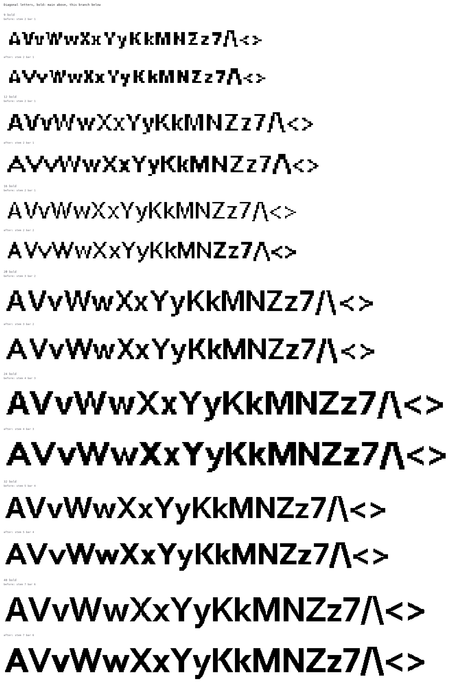
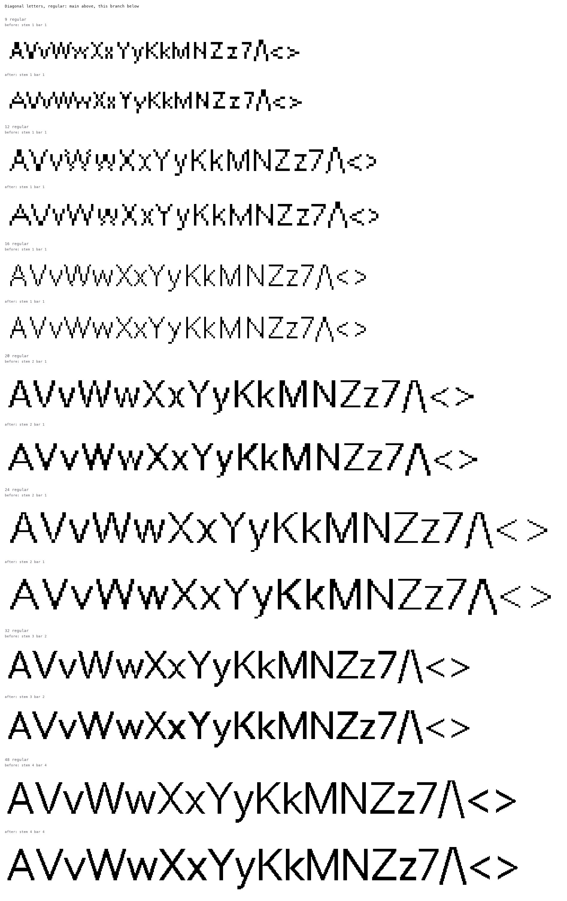
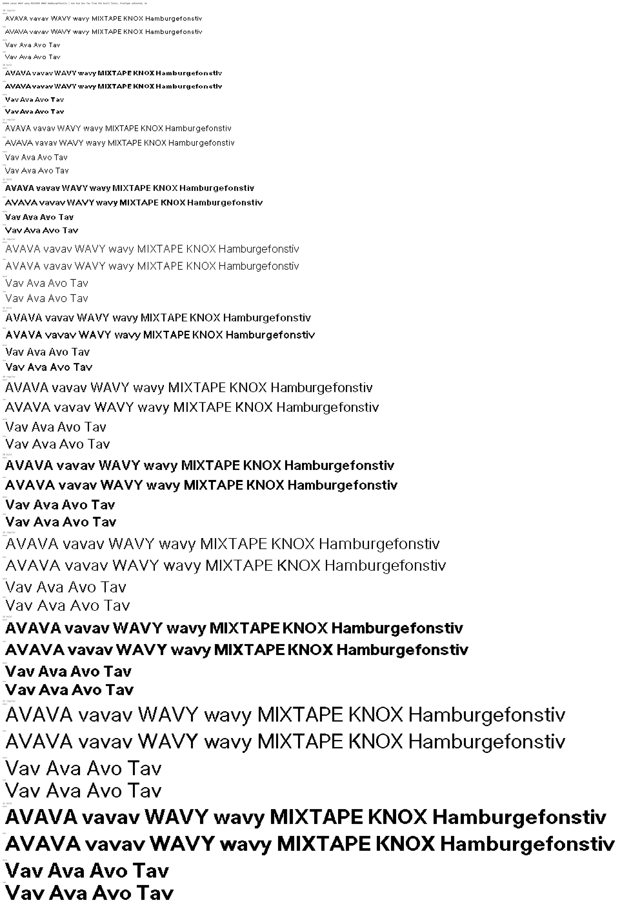
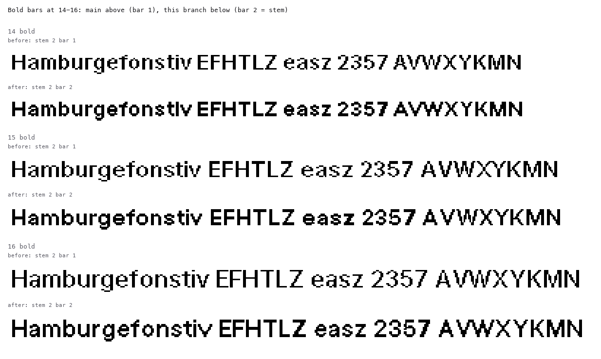
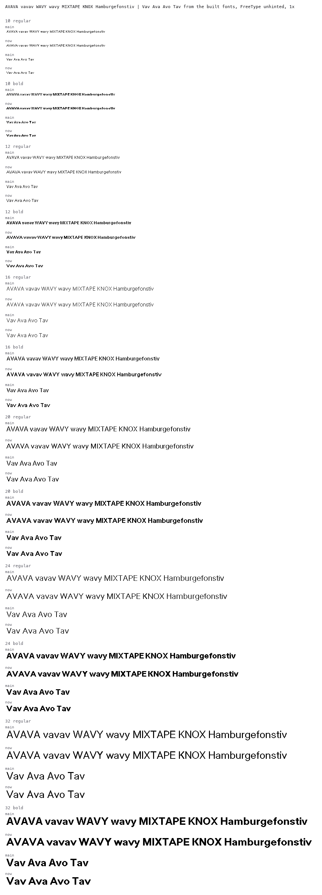
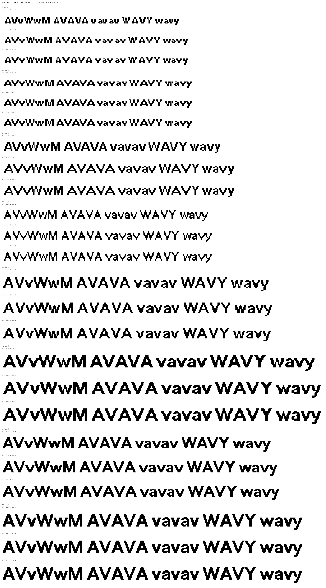
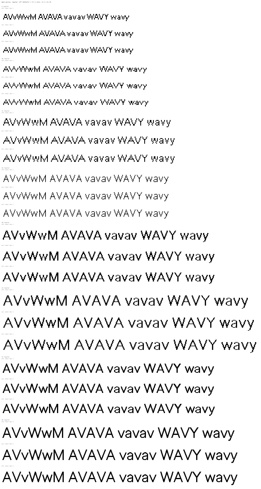

Also in `img/`: `diag-light.png`, `alpha-light.png`, `alpha-regular.png`, `alpha-bold.png`, `parity-light.png`.

What I saw in them:

- A, V, W, M, N, K, X read straight from 12 px up in every weight I looked at.
- The two defects of the prototype are gone. A 10 Bold has a filled apex row and legs two pixels wide. W 12 Bold has outer strokes at the stem. Its inner strokes are still 1 px: there is no room for four 2 px strokes in 12 columns.
- A 9 Bold is unchanged from main, legs `.#..#.` for two rows, in every mode. It is no longer the outlined triangle of the prototype, and its legs are still 1 px in a 2 px weight: 6 columns have no room for two 2 px legs and a counter.
- Bold at 14 to 16 is plainly heavier than on main: every bar doubled. The counters of e, a, s stay open. 16 Bold now has bars at the stem and 17 Bold has them one under.
- At 32 and 48 Regular, X, x, K and k look a little heavier than on main. The measure says they are now at the stem, where they were under it.
- With `--parity all`, W 24 Regular has one row a pixel wider than its neighbours near the feet.
- `/\` reads as one `Λ` shape in the Bold diagonal sheet, on main's row as much as on this branch's.
- These notes are from the sheets as drawn with parity off, apart from the last and the proofs under Spacing. After the regeneration with `avv` I looked at the two proofs and at the Regular and Bold diagonal sheets from 9 to 20: in Regular, A has a single apex at 9, 12, 16 and 20, and V at 9 and 12 keeps a foot two pixels wide, as the count above says.

### Decided

- Apex parity: A, V, v only (`--parity avv`), and it is the importer's default, not an option to remember. It takes the doubled apex from 190 of 378 to 24 (32 of 72 to 5 on the sheet grids). `all` removes no more on those grids and adds the uneven row in W 24 Regular. `off` and `all` stay as values of the flag.
- Bold bars at 14 to 16 stay at the stem, 2 px. The request was for weight that is consistent across the characters of one size and weight, and a bar under the stem is the inconsistency inside those three instances. The rule is as built.

### Open

- Bold bars at 33 to 36 are 3 px against a 5 px stem, where 31, 32 and 37 are one under. Not changed here.
- From 17 up the Bold bar is one under the stem: the rule does not hold there, because the stem grows faster than the x-height.
- 10 px Bold is tight around A, V, v after the redraw (see Spacing).

### Not verified

- A browser. The proof lines are FreeType renders of the built fonts, not Chrome or Safari.
- Spacing beyond the two proof lines, the gap counts above and the sheets. No running text was set, and the 43 advances of the bar refit were not looked at one by one.
- The 4x proof was looked at reduced (two to four screen pixels to one), the 1x proof at full size. After the regeneration I looked at the Regular and Bold diagonal sheets at 9 to 20 only. The Light sheets, the alphabet and parity sheets and the sizes above 20 were not looked at again.
- Why 24 A V v drawings keep an apex wider than a leg.
- `--parity all` and `--parity off` as built fonts: `all` was run on eight grids only; `off` was the previous state of this branch, built and checked then.
- `weight.py` was not checked letter by letter against pictures. Its round and bar counts at 25 to 48 may include strokes it misreads.
